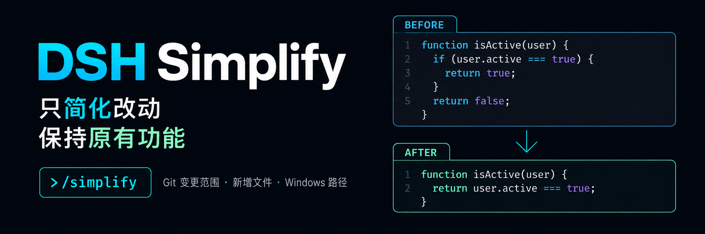

<p align="center">
  
</p>

<div align="center">

# DSH Simplify

**Simplifiez le code récemment modifié dans DeepSeek Harness tout en préservant son comportement.**

[简体中文](README.zh-CN.md) · [English](README.en.md) · [日本語](README.ja.md) · [Español](README.es.md) · [Français](README.fr.md) · [Deutsch](README.de.md) · [Русский](README.ru.md) · [Português](README.pt.md)

[Journal des modifications](CHANGELOG.md) · [Apache-2.0](LICENSE)

[](LICENSE)
[](https://www.npmjs.com/package/@michengai/dsh-simplify)
[](https://github.com/deepseek-ai/deepseek-harness)
[](#installation)
[](https://nodejs.org/)

</div>

> DSH Simplify est un plugin maintenu par la communauté pour DeepSeek Harness, et n'est pas un produit officiel de DeepSeek AI. Saisissez `/simplify` dans la session actuelle pour demander à l'Agent d'organiser le code dans le périmètre des modifications Git, en améliorant la lisibilité tout en préservant le comportement original.

Les invites envoyées à l'Agent restent en chinois simplifié, tandis que les libellés et descriptions des commandes s'adaptent automatiquement à la langue de l'interface.

## Fonctionnalités

- **Ciblage précis des modifications** : Limite les modifications au périmètre Git afin d'éviter d'impacter des fichiers non concernés.
- **Prise en charge des nouveaux fichiers** : Permet une revue complète des fichiers non suivis (untracked) ainsi que des dépôts sans commit initial.
- **Sélection flexible de la portée** : Examine par défaut l'espace de travail, avec option pour la zone de staging ou un commit spécifique.
- **Revue rétrospective** : Lorsque l'espace de travail est propre, permet d'examiner le commit le plus récent.
- **Arrêt sécurisé en cas d'incohérence** : Interruption immédiate en cas de conflit ou de modification concurrente.

## Écosystème de produits DSH

| Plugin | Utilisation |
| --- | --- |
| [Codex UI](https://github.com/MichengAI/dsh-codex-ui) | Organisation des projets et sessions, recherche de tâches et navigation fluide |
| [Agency Agents](https://github.com/MichengAI/dsh-agency-agents) | Sélection et invocation de rôles spécialisés |
| [Skills Manager](https://github.com/MichengAI/dsh-skills-manager) | Découverte, activation, création et gestion des compétences locales |
| [Archive Manager](https://github.com/MichengAI/dsh-archive-manager) | Recherche, restauration et nettoyage des sessions archivées |
| [IM Connect](https://github.com/MichengAI/dsh-im-connect) | Envoi de tâches et réception de réponses via les plateformes de messagerie |
| [Automation](https://github.com/MichengAI/dsh-automation) | Planification et exécution automatisée de tâches |
| [BTW](https://github.com/MichengAI/dsh-btw) | Questions contextuelles rapides sans interrompre la tâche principale |
| [Simplify](https://github.com/MichengAI/dsh-simplify) | Simplification du code dans le périmètre Git avec `/simplify` |
| [PUA](https://github.com/MichengAI/dsh-pua) | Encadrement de l'Agent pour persévérer et valider avant finalisation |
| [Code Review](https://github.com/MichengAI/dsh-code-review) | Revue de code indépendante avec rapport dans la session via `/review` |
| [Codex Pet](https://github.com/MichengAI/dsh-codex-pet) | Compagnon de bureau pour les notifications et approbations |

## Prérequis

- DeepSeek Harness `0.2.x` (`>=0.2.0-rc.1 <0.3.0-0`), vérifié avec `0.2.0-rc.1`, `0.2.0-rc.2`, `0.2.1-rc.1`～`0.2.1-rc.5`, `0.2.2-rc.1`, `0.2.2-rc.2`, `0.2.2-rc.3`.
- Les versions antérieures à `0.2.0-rc.1` sont rejetées. Si vous utilisez `0.1.x`, installez la version `0.1.16`.
- Node.js >= 22.19, Git accessible dans le PATH.
- Session liée à un dépôt Git local.

## Installation

Les commandes ci-dessous utilisent le profil `web`.

### Demander à l'Agent d'effectuer l'installation (Recommandé)

```text
Installez le plugin DSH @michengai/dsh-simplify dans mon profil web local en exécutant : dsh plugin --profile web add @michengai/dsh-simplify@1.0.9 --registry=https://registry.npmjs.org/. Exécutez ensuite dsh --profile web --dump-config pour confirmer la configuration.
```

### Installation manuelle depuis npm

```powershell
[Console]::OutputEncoding = [System.Text.Encoding]::UTF8
$OutputEncoding = [System.Text.Encoding]::UTF8

dsh plugin --profile web add @michengai/dsh-simplify@1.0.9 --registry=https://registry.npmjs.org/
```

<details>
<summary>Installation depuis un package local</summary>

Téléchargez le fichier tgz publié sur [GitHub Release](https://github.com/MichengAI/dsh-simplify/releases/tag/v1.0.9) et exécutez :

```powershell
[Console]::OutputEncoding = [System.Text.Encoding]::UTF8
$OutputEncoding = [System.Text.Encoding]::UTF8

dsh plugin --profile web add .\michengai-dsh-simplify-1.0.9.tgz --ignore-scripts
```

</details>

### Rechargement et vérification

Installez ou mettez à jour une fois la tâche courante achevée. Utilisez la commande de rechargement de l'application de bureau ou redémarrez `dsh web`.

## Utilisation

```text
/simplify
```

### Options de portée

| Commande | Périmètre pris en compte |
| --- | --- |
| `/simplify` | Différence nette entre HEAD et l'espace de travail (fichiers non suivis inclus). Examine le dernier commit en l'absence de modifications |
| `/simplify --staged` | Uniquement la zone d'index (staged) |
| `/simplify --ref=main` | Différence entre le commit indiqué et l'espace de travail actuel |
| `/simplify --ref HEAD` | Portée explicite de HEAD sans retour sur le commit précédent |
| `/simplify src/a.ts "src/fichier avec espace.ts"` | Uniquement les fichiers spécifiés |
| `/simplify src` | Développe les fichiers modifiés dans le répertoire |
| `/simplify -- --special.ts` | Le séparateur `--` permet de spécifier des chemins débutant par un tiret |

## Dépannage

**La touche Entrée efface le texte mais aucune réponse n'apparaît** : Une revue sans modification ne déclenche pas d'appel vers l'Agent.

**Le répertoire courant n'est pas un dépôt Git** : Lancez la commande dans un projet Git initialisé.

**Des fichiers indexés comportent des modifications non préparées** : Préparez ou validez ces changements avant d'exécuter `--staged`.

## Limites d'exécution

Le plugin exécute uniquement des requêtes Git en lecture seule et lit les fichiers locaux ; il n'exécute jamais `git add`, `commit` ou `reset`.

## Désinstallation

```powershell
[Console]::OutputEncoding = [System.Text.Encoding]::UTF8
$OutputEncoding = [System.Text.Encoding]::UTF8

dsh plugin --profile web remove @michengai/dsh-simplify
```

> Pour le guide de développement et de vérification, veuillez consulter la version en [简体中文](README.zh-CN.md#二次开发) ou [English](README.en.md#development).

## Licence

[Apache-2.0](LICENSE)，Copyright 2026 MichengAI.
